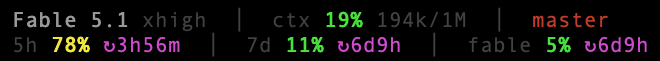

# claude-statusline

A two-line status line for [Claude Code](https://docs.anthropic.com/en/docs/claude-code) on macOS, showing the model, context and usage.



Line 1: model and effort, context used, git branch with lines added and removed.
Line 2: one gauge per limit with the time to its reset. `≈` marks a cached reading that may be behind. Yellow at 60 %, red at 80 %.

## Install

Needs `jq` (`brew install jq`).

```sh
git clone https://github.com/AndreaCacioppo/claude-statusline.git ~/.claude/claude-statusline
```

Add to `~/.claude/settings.json`:

```json
{
  "statusLine": {
    "type": "command",
    "command": "~/.claude/claude-statusline/statusline.sh",
    "refreshInterval": 10
  }
}
```

Restart Claude Code.

## How it works

Claude Code pipes the model, context and, after the first response, the 5-hour and 7-day limits to the script. Per-model weeks are not in that data: the script reads them from the usage snapshot in `~/.claude.json` and refreshes it in the background with `claude -p --no-session-persistence /usage` when it is older than 330 seconds. That call sends nothing to a model, costs no tokens and leaves no transcript. The snapshot also updates the 5-hour and 7-day gauges when it is newer, so an idle session sees usage from other sessions.

A redraw costs about 55 ms; a refresh about 5 seconds in the background, at most 11 times an hour.

Set `CLAUDE_STATUSLINE_REFRESH_SECONDS` in the command string to change the interval, `0` to turn the refresh off. State lives in `~/.claude/cache/statusline-*`.

## License

MIT. If you use this, a link back to https://github.com/AndreaCacioppo/claude-statusline is appreciated.
